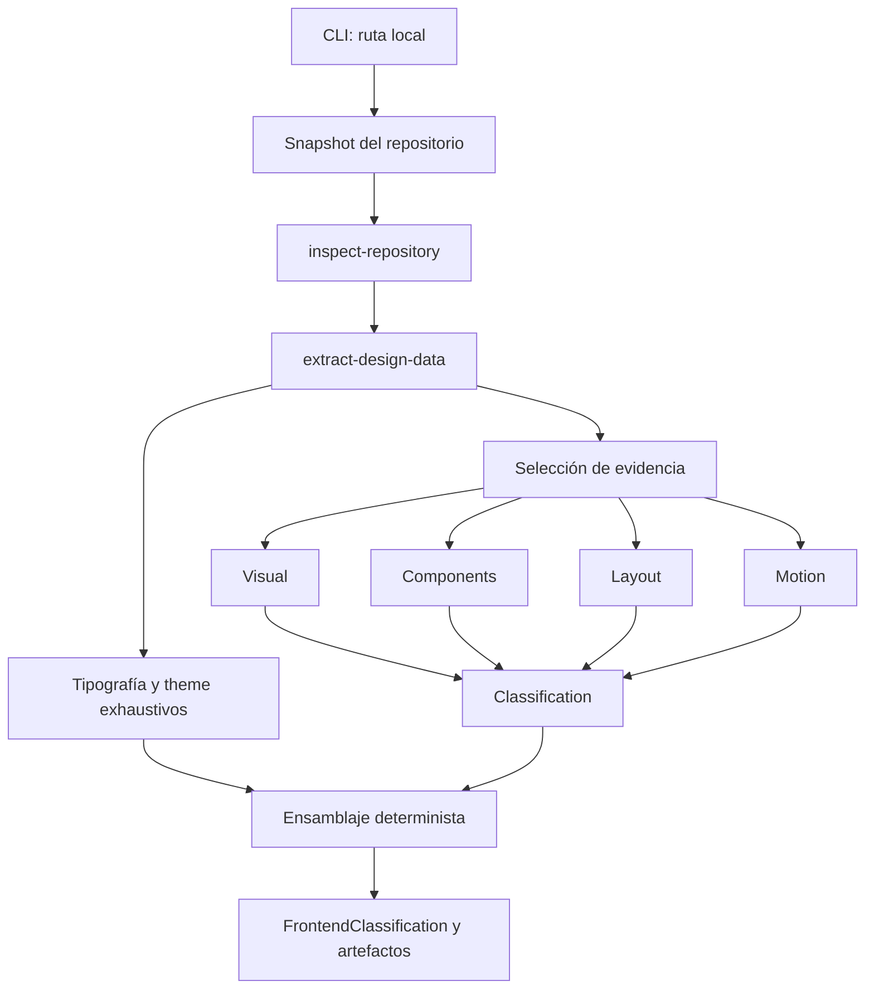

# Frontend Classifier Agent

CLI para inspeccionar un repositorio local, analizar su frontend con agentes especializados y generar una clasificación de su lenguaje visual y sistema de UI.

Combina extracción determinista de código con análisis LLM acotado por evidencia. No envía el repositorio completo a cada agente: cada especialista recibe únicamente los archivos y señales que necesita.

## Qué genera

Al terminar un análisis puedes elegir uno o más artefactos:

- `classification.json`: resultado estructurado completo (`FrontendClassification`).
- `UI_SKILL.md`: guía reutilizable para recrear el lenguaje de UI del proyecto.
- `design-report.md`: reporte de identidad visual, componentes, layout y motion.

Los resultados se guardan con historial de ejecuciones:

```text
artifacts/
└── nombre-del-proyecto/
    ├── latest/
    │   ├── classification.json
    │   ├── UI_SKILL.md
    │   └── design-report.md
    └── runs/
        └── 2026-08-25T14-30-00-a1b2c3d4/
            ├── classification.json
            ├── UI_SKILL.md
            ├── design-report.md
            └── metadata.json
```

`latest/` contiene una copia del último resultado. Las carpetas de `runs/` nunca se sobrescriben y `artifacts/` está ignorado por Git.

## Requisitos

- [Bun](https://bun.sh/) 1.3 o superior.
- Una API key de Google Gemini o DeepSeek.
- Acceso local de lectura al repositorio que quieres analizar.

## Instalación

```bash
bun install
cp .env.example .env
```

Configura uno de estos proveedores en `.env`.

### Google Gemini

```dotenv
AI_PROVIDER=google
GOOGLE_MODEL=gemini-3.5-flash
GOOGLE_GENERATIVE_AI_API_KEY=tu_api_key
```

### DeepSeek

```dotenv
AI_PROVIDER=deepseek
DEEPSEEK_MODEL=deepseek-v4-flash
DEEPSEEK_API_KEY=tu_api_key
```

No subas `.env` ni claves al repositorio.

## Ejecutar un análisis

Desde la raíz del proyecto:

```bash
bun run analyze
```

El CLI acepta una ruta absoluta, relativa o una frase que describa la ubicación:

```text
¿Dónde está el proyecto? (ruta o frase)
> documents/programacion/bazza.cloud
```

Después del análisis selecciona artefactos y destino:

```text
¿Qué artefactos deseas generar?
  1. classification.json
  2. UI_SKILL.md
  3. design-report.md
  4. Todos

¿Dónde deseas guardarlos?
  1. Carpeta por defecto: ./artifacts
  2. Dentro del repositorio analizado
  3. Ruta personalizada
```

## Cómo funciona



El workflow tiene cuatro etapas principales:

1. **Inspección**: detecta framework, librerías, estructura y archivos relevantes.
2. **Extracción determinista**: obtiene tipografía, colores, variables CSS y gradientes sin LLM.
3. **Especialistas**: Visual, Components, Layout y Motion reciben evidencia específica y validan conclusiones contra señales observadas.
4. **Clasificación**: sintetiza los análisis; después el código ensambla el resultado final sin pedir al modelo que copie datos deterministas.

## Arquitectura

```text
src/
├── cli/                     # Terminal, carga de repositorio y artefactos
│   ├── artifacts/           # Generadores deterministas de JSON y Markdown
│   ├── prompts/             # Preguntas del CLI
│   ├── repository/          # Resolución de rutas y snapshot local
│   └── runners/             # Inicio del workflow
└── mastra/
    ├── agents/              # Prompts y responsabilidades de especialistas
    ├── schemas/             # Contratos Zod de entradas y salidas
    ├── tools/               # Inspectores y extractores deterministas
    ├── lib/                 # Routing de evidencia, grounding, prompts y modelos
    └── workflows/           # Orquestación declarativa del análisis
```

### Agentes

| Agente | Responsabilidad |
|---|---|
| Visual Style | Identidad visual, densidad, consistencia y personalidad. |
| Components | Familias, variantes, estados, bordes, sombras y shape language. |
| Layout | Jerarquía, composición, navegación, spacing y responsive layout. |
| Motion | Timing, easing e interacciones solo si existe evidencia concreta. |
| Classification | Síntesis cross-domain y resumen global. |

## Agentes en detalle

Los agentes viven en [`src/mastra/agents/`](./src/mastra/agents/). Cada uno es
una instancia de `Agent` de Mastra con una responsabilidad limitada, un prompt
de sistema y el modelo seleccionado en `lib/model-provider.ts`. No se llaman
directamente desde el CLI: el workflow los invoca dentro del step
`specialist-analyses` o `classify-frontend`.

```text
evidencia determinista + prompt específico
                 ↓
            agente LLM
                 ↓
       JSON validado por schema Zod
                 ↓
 grounding / normalización determinista
```

### 1. Visual Style Agent

Archivo: [`visual-style-agent.ts`](./src/mastra/agents/visual-style-agent.ts)

Su pregunta central es: **¿cuál es la identidad visual del frontend?**

Recibe metadata mínima del proyecto, tipografía compacta, un resumen semántico
del theme y evidencia visual seleccionada. No recibe todos los colores, todas
las variables CSS ni el snapshot completo; esos datos siguen disponibles de
forma exhaustiva para `classification.json`.

Devuelve `VisualStyleAnalysis` con:

- `primaryStyle` y `secondaryStyles`;
- formalidad, personalidad, densidad y complejidad visual;
- nivel de consistencia;
- observaciones con rutas fuente;
- `reasoningSummary` obligatorio.

Puede interpretar una combinación de colores, tipografía y evidencia como una
identidad “premium” o “tecnológica”, por ejemplo, pero no puede inventar
archivos, componentes, librerías ni decisiones visuales ausentes de la
evidencia.

### 2. Component Analysis Agent

Archivo: [`component-agent.ts`](./src/mastra/agents/component-agent.ts)

Analiza las convenciones compartidas por componentes reutilizables:

- familias conceptuales (`Button`, `Sheet`, `Alert`);
- shape language y radio;
- bordes y sombras;
- variantes y estados de interacción;
- nivel de reutilización y consistencia.

Antes de su llamada, `component-grounding.ts` extrae candidatas desde imports,
JSX, implementaciones locales y clases CSS/Tailwind. El agente recibe esa lista
como `observedCandidates` y solo puede devolver valores presentes allí.

Esto evita inferencias comunes pero inválidas: tener una dependencia de shadcn
no demuestra que el repo use la variante `ghost`; importar un componente no
permite inventar una familia distinta. Los primitives como `SheetContent` se
preservan como evidencia, pero el resultado normaliza la familia conceptual
como `Sheet`.

### 3. Layout Analysis Agent

Archivo: [`layout-agent.ts`](./src/mastra/agents/layout-agent.ts)

Analiza la organización espacial de las páginas:

- estructura dominante y flujo de secciones;
- densidad, spacing, jerarquía y alineación;
- patrones de navegación;
- comportamiento responsive;
- patrones de composición.

Debe respaldar sus conclusiones con rutas concretas. Tiene una regla adicional
para grids: nombres como `AnimatedGridPattern` o `MeshGrid` pueden describir un
fondo visual, pero no prueban una composición CSS Grid. Para reportar una grid,
la evidencia debe contener `display: grid`, `grid-template-*`, clases
`grid`/`grid-cols-*` u otra estructura equivalente inspeccionada.

### 4. Motion Analysis Agent

Archivo: [`motion-agent.ts`](./src/mastra/agents/motion-agent.ts)

Analiza solo motion verificable:

- durations y easing;
- hover, tap y micro-interacciones;
- entradas, salidas, transforms y scroll effects;
- intensidad, consistencia y patrones recurrentes.

`motion-grounding.ts` prepara valores observados y valida la respuesta. Una
librería instalada, `AnimatePresence` o un nombre como `AnimatedGridPattern`
solo demuestran su presencia, no una animación visible ni un lenguaje de
motion. Si no existe configuración concreta, el contrato esperado es:

```json
{
  "transitionDurations": {
    "commonValues": [],
    "dominantRange": "insufficient evidence"
  },
  "easing": {
    "commonValues": [],
    "dominantStyle": "unspecified"
  },
  "motionIntensity": "none",
  "consistency": "low",
  "patterns": []
}
```

### 5. Frontend Classification Agent

Archivo: [`classification-agent.ts`](./src/mastra/agents/classification-agent.ts)

Es el sintetizador final, no un segundo analista del repositorio. Recibe:

- metadata compacta del proyecto;
- outputs ya validados de Visual, Components, Layout y Motion;
- un resumen compacto de typography/theme.

Solo produce conclusiones transversales como `overallSummary`, identidad de
diseño, características dominantes, principios y patrones compartidos. No
vuelve a generar colores, tipografía, componentes, layout o motion. Luego el
workflow ensambla determinísticamente el `FrontendClassification` final con los
outputs de especialistas y los datos exhaustivos extraídos sin LLM.

### Schemas, validación y reparación

Cada agente debe devolver JSON compatible con un schema Zod en
[`src/mastra/schemas/`](./src/mastra/schemas/). El workflow valida dos niveles:

1. **Estructura**: campos requeridos, enums y tipos correctos.
2. **Grounding semántico**: Components, Motion y Layout comprueban que ciertas
   afirmaciones estén soportadas por señales deterministas.

Si el output estructurado falla, el workflow puede solicitar una única
reparación que contiene solamente el objeto inválido y los errores. No vuelve a
enviar el repositorio completo para reparar una respuesta.

### Grounding y control de contexto

- El snapshot completo solo se usa para indexar y seleccionar evidencia.
- Cada agente recibe un DTO explícito; no recibe la lista general de archivos.
- Components, Motion y Layout aplican validaciones deterministas para impedir inferencias no demostradas.
- Visual recibe un resumen semántico compacto de colores/variables, mientras `classification.json` conserva el dataset exhaustivo.
- El workflow puede hacer como máximo una reparación de structured output por agente cuando el JSON no cumple su contrato.

## Scripts

```bash
# Análisis interactivo
bun run analyze

# Preflight determinista: evidencia y tamaños de contexto
bun run evidence:preflight -- /ruta/al/repositorio

# Verificación de tipos
bunx tsc --noEmit

# Comprobaciones deterministas de grounding
bun src/cli/deterministic-checks.ts

# Build de Mastra
bun run build

# Mastra Studio
bun run dev
```

## Límites y expectativas

- El resultado depende de los archivos que el snapshot puede leer; directorios generados y `node_modules` se excluyen.
- Una librería instalada no prueba automáticamente una decisión visual, componente o animación: debe existir evidencia de uso/configuración.
- La clasificación usa LLM y puede variar entre ejecuciones; los extractores de colors, typography y grounding son deterministas.
- El uso de tokens depende del provider y del repositorio analizado. El CLI imprime un resumen por especialista al terminar.

## Desarrollo

Antes de cambiar agentes, schemas o workflow:

```bash
bunx tsc --noEmit
bun src/cli/deterministic-checks.ts
```

Para cambios de Mastra, consulta [AGENTS.md](./AGENTS.md) y la skill local de Mastra antes de modificar APIs del framework.
